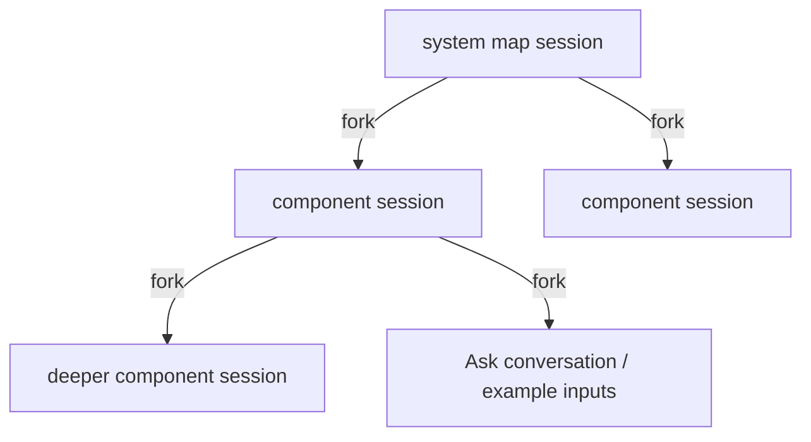

# cxplr — Code Explore

Learn an unfamiliar repository top-down. Point it at a project and get a local web
map of its components, how they interact and the main data flows. Then drill into any
component for the next level of detail, down to the cited source lines.

| Level | Shows |
| --- | --- |
| System | Main components, datastores, external systems, actors; 2–6 end-to-end data flows |
| Component (repeatable) | Internal modules/classes/functions, how they handle the component's interfaces |
| Source | The exact file and line behind every claim, plus directory browsing |

The exploration is done by [Codex](https://github.com/openai/codex) through a
long-lived `codex app-server`, in read-only sessions inside the target repository.
cxplr builds the prompt for each zoom level, constrains the answer to a JSON schema,
checks every citation against the files on disk, caches the result and serves the
UI. Sessions form a tree that mirrors the map, so later work starts from what
earlier explorations already read (see [Codex sessions](#codex-sessions)).

## Requirements

- Rust toolchain (to build)
- `codex` on `PATH`, already logged in, with `codex app-server` (experimental in
  Codex 0.166; cxplr stops with a clear error if it is missing). The model and
  reasoning effort come from your Codex config unless `--model` is given

## Run

```sh
cargo build --release
./target/release/cxplr /path/to/repo --index   # map the project, then open the browser
./target/release/cxplr /path/to/repo           # browse what is cached: http://127.0.0.1:7878
```

`--index` explores the system map and then every component worth a deeper map,
several at a time, prints progress, and opens the browser when done. Browsing then
reads everything from the cache and never calls Codex on its own: a level that is
not indexed shows **Explore now**, and stale maps offer **Refresh**.

| Indexing option | Default | Meaning |
| --- | --- | --- |
| `--depth N\|full` | 2 | Levels to map: 1 = system, 2 = system and its components, …; `full` maps the whole hierarchy |
| `--jobs N` | 4 | Explorations running at the same time |
| `--min-lines N` | 300 | Components with fewer text lines stay leaves (the source view covers them) |
| `--index-only` | | Index and exit (exit code 1 if any exploration failed) |

Indexing is resumable and incremental: fresh maps are skipped, so re-running after an
interruption or a commit only explores what is missing or changed. For reference,
`sre-agent` (≈850 files) indexed at depth 2 in about 16 minutes with 9 explorations
and 3.5M input tokens.

With `--depth full`, recursion stops at a component that is not explorable, is an
external system or actor, has fewer than `--min-lines` lines, or covers no fewer
files than the map it appears in. The last rule guarantees termination: every level
covers strictly fewer files. Full depth can mean dozens to hundreds of explorations
(each typically 2–7 minutes and 150–700k input tokens), so a common pattern is to
index at depth 2 first and deepen later: maps already cached are reused, and only
the new levels are explored. Raise `--min-lines` to keep the hierarchy coarser.

Other options: `--port`, `--host` (keep loopback; the API serves repository files),
`--open`, `--model`, `--codex <path>`, `--timeout-mins` (per exploration or question,
default 20), `--cache-dir`, `--lsp LANG=COMMAND` (repeatable), `--no-lsp`,
`--forget-sessions`, `--install-skill`.

## Using the map

- Click a box or arrow: summary, paths, interactions and evidence in the side panel.
- Double-click a box, or **Explore inside**: map that component one level deeper.
  Breadcrumbs at the top go back up.
- Click a data flow: its steps are highlighted and numbered on the map.
- Click a citation or path: source viewer at that line.
- Drag a box to move it when labels overlap; edges follow. Positions are saved per
  map (repository, commit, level) in browser storage. **Reset layout** discards them.
- Mouse wheel zooms, dragging the background pans, `F` fits, `Esc` clears the selection.
- Box labels show whether the inner map is cached: **open ›** (fresh), **open
  (stale) ›**, or **explore ›** (not explored yet).

## Simulation

Each data flow has **▶**: N inputs (set in **Inputs**, 1–20) travel the flow's steps
as tokens, staggered, pausing at each box. When a step reaches a component with its
own cached map, **Follow inside** opens that map and plays the flow there that
involves the component the input came from.

**Example inputs** under a selected flow asks Codex (read-only, about 1–3 minutes,
cached) for 2–5 concrete inputs that take different branches: the normal path,
rejections, failures, retries. Each one has its own lettered token and route, shows
its data at every hop while it plays, and cites the code that decides each step.

## Reading source

The source viewer highlights syntax (highlight.js, bundled; no network access).

- Click a name: the side pane shows its documentation/signature, definitions and, on
  request, references. Ctrl/⌘-click jumps straight to a single definition.
- **‹ / ›** or Alt+←/→ walk the navigation history.
- The chip in the header shows the language server state. Files without a server
  (YAML, shell, configs, …) or with a failed server fall back to whole-word text
  search across the repository (respecting `.gitignore`).

Language servers are found on `PATH` and started on first use, one per language,
with the repository as workspace:

| Language | Servers tried |
| --- | --- |
| Rust | `rust-analyzer` (build scripts and proc macros disabled) |
| Python | `pyright-langserver --stdio`, `basedpyright-langserver --stdio`, `pylsp`, `jedi-language-server` |
| TypeScript / JavaScript | `typescript-language-server --stdio` |
| Go | `gopls` |
| C / C++ | `clangd` |

Override or add one with `--lsp`, e.g. pyright without a global install:

```sh
cxplr /path/to/repo --lsp "python=npx -y -p pyright@1 pyright-langserver --stdio"
```

`--lsp python=` disables a language. Language servers can run project tooling
(for example `gopls` runs `go list`, TypeScript loads tsconfig plugins); use
`--no-lsp` for repositories you do not trust.

### Rust

A rustup installation ships `rust-analyzer` on `PATH` only as a proxy; until the
component is installed it fails with “Unknown binary 'rust-analyzer' in official
toolchain” and the viewer falls back to text search. Install it once:

```sh
rustup component add rust-analyzer
rust-analyzer --version
```

cxplr then picks it up automatically (`language server: rust = rust-analyzer` at
startup). On first use it loads the whole Cargo workspace, which can take from
seconds to over a minute; the header chip shows `indexing…` until it is ready, and
clicks before that may return nothing.

Build scripts, proc macros and check-on-save are disabled so browsing never compiles
or runs project code; items generated by macros or build scripts (e.g. `serde`
derives, `include!` of build output) may therefore not resolve. To use another
binary or toolchain:

```sh
cxplr /path/to/repo --lsp "rust=$HOME/.local/bin/rust-analyzer"
cxplr /path/to/repo --lsp "rust=rustup run nightly rust-analyzer"
```

## Asking questions

**About code, inline.** Select lines in the source viewer and click **Ask about
lines…** (or use **Ask about selection** in the header; without a selection it covers
the whole file). A thread opens right under the selection, code-review style: ask,
read the answer, ask follow-ups in place. Each thread is its own conversation and
stays attached to its lines when you reopen the file.

**About the map.** The **Ask** tab sends a question together with the current map and
the selected component, and lists all code threads (click one to jump to it).

Every conversation's first question forks the session that explored the current map;
follow-ups continue in that session, so Codex remembers what it read and answered
(a follow-up typically runs few or no commands, with most input cached). The Ask tab's
**Conversation** chip shows this; its ✕ starts a new conversation from the map you
are on. Answers are Markdown; every `path:line` in them opens the source viewer, and
citations are checked against the files like map evidence. Conversations live in the
page and are cleared on reload (their Codex sessions remain).

## Atlas and the Codex skill

Every cached map is also written as Markdown to `.cxplr/atlas/`, laid out like the
map hierarchy, for people and for other agents:

```
.cxplr/atlas/README.md                 # system: summary, components, interactions, flows
.cxplr/atlas/<component>/README.md     # one page per explored component
```

Each page has a **Status** line (fresh, or stale with the changed files), a table of
components with their paths and links to deeper pages ("not explored" where there is
none), interactions, data flows and `path:line` citations. The atlas is rebuilt when
cxplr starts, after indexing and after each exploration from the browser.

```sh
cxplr --install-skill    # writes $CODEX_HOME/skills/cxplr/SKILL.md (default ~/.codex)
```

The skill tells any Codex session in a repository with `.cxplr/atlas/README.md` to
orient from the atlas before exploring: start at the system page, follow links to the
relevant component, open citations before relying on them, and read the changed files
of stale pages directly. Codex decides when to load a skill, so this is guidance, not
enforcement. Re-run `--install-skill` after upgrading cxplr.

## Codex sessions



- The system map is explored in a new session; each component in a **fork** of the
  session of the map it appears in, so it starts with its ancestors' exploration
  already in context (and largely in the provider's prompt cache) while siblings
  still run in parallel.
- A stale map is refreshed **inside its own session**: Codex gets the exact list of
  changed files, re-reads them and returns the updated map, instead of exploring
  from scratch. If that session no longer exists, it is explored afresh.
- Questions and example inputs fork the session of the map you are viewing.
- Sessions are persisted by Codex (forking requires it) and named
  `cxplr: <repo> › …`, so they appear in `codex resume`; each map shows its session
  id, and `codex resume <id>` continues it interactively. `--forget-sessions`
  deletes every session cxplr created for the project (listed in
  `.cxplr/sessions.json`); cached maps stay, and later work starts new sessions.

## Trust model

- Maps are model-generated. ✓ on a citation means the file exists inside the
  repository and has that line; it does not prove the claim. `!` marks citations
  that failed the check, and dropped references are listed under Diagnostics.
- Codex sessions run read-only (`sandbox: read-only`), never ask for approval (any
  request that slips through is declined), with hooks, plugins, apps, memories and
  browser/computer tools disabled. They can still run read-only commands, including
  scripts in the target repository. A trusted project's `.codex` configuration
  still applies.
- The source endpoint only serves paths that resolve inside the repository; symlinks
  leading outside are refused.

## Cache

Everything is cached in `.cxplr/` inside the explored directory (it contains its
own `.gitignore`, so git ignores it; `--cache-dir` puts it elsewhere, e.g. for
read-only checkouts).

A map's key is its scope plus the content of every file it covers (git blob hashes of
the working tree), the prompt version and the model. So:

- a component keeps its map across commits, branches and uncommitted edits that do
  not touch its files; committing changes you already had uncommitted invalidates
  nothing;
- when its files change, the last map is still shown, marked stale with the exact
  files added, removed or changed, until **Refresh** or the next `--index`;
- going back to earlier content (e.g. checking out an older branch) finds that
  content's map again.

Example inputs are cached per map content and flow. Delete `.cxplr/` to start over.
