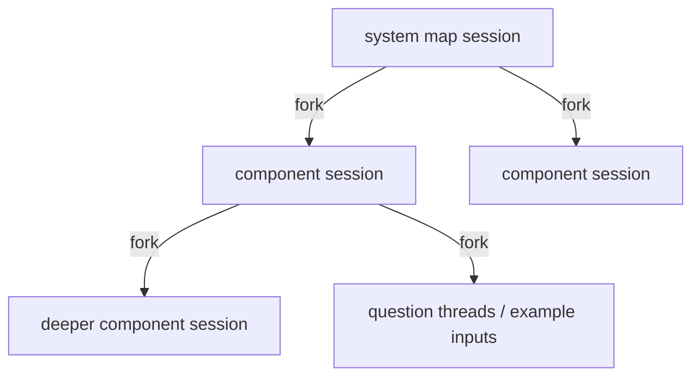

# cxplr — Code Explore

Learn an unfamiliar repository top-down. cxplr maps a project's components, how they
interact and its main data flows, then lets you drill into any component, down to the
cited source lines, in a local web UI.

- **Maps at every level**: system, component, sub-component…, each with interactions,
  data flows and `file:line` evidence checked against the code.
- **Full-project indexing** up front (`--index`), then browsing straight from a
  content-addressed cache that survives commits.
- **Simulation**: watch N inputs travel a data flow; generate concrete example inputs
  that take different branches, with the data at every step.
- **Source viewer** with tabs that keep their place, a functions/classes outline, find
  in file and across the repository, syntax highlighting and code navigation through
  language servers (Rust, Python, TS/JS, Go, C/C++, Scala), with text-search fallback.
- **Ask questions** inline under selected code or about the current map; follow-ups
  continue the same agent session.
- **Atlas**: every map as Markdown in `.cxplr/atlas/`, plus a Codex / Claude Code skill
  so your other sessions can use it.

The exploration is done by [Codex](https://github.com/openai/codex) (default) or
[Claude Code](https://docs.anthropic.com/en/docs/claude-code), in read-only sessions
that form a tree mirroring the map (see [Engines](#engines) and [Sessions](#sessions)).

## Requirements

- Linux or macOS (x86_64 or arm64).
- One engine, logged in:
  - `codex` on `PATH` with `codex app-server` (experimental in Codex 0.166), or
  - `claude` (Claude Code) on `PATH`, with `--restricted` (Claude Code 2.1.3xx;
    `claude update` otherwise), for `--engine claude`.

  cxplr stops with a clear error if the engine is missing or too old. Model and
  reasoning effort come from the engine's own config unless `--model` is given.
- Optional: language servers for code navigation (see [Source viewer](#source-viewer)).

## Engines

| | `--engine codex` (default) | `--engine claude` |
| --- | --- | --- |
| Runs | one long-lived `codex app-server` | `claude -p` per turn (headless Claude Code) |
| Account | your Codex login | your Claude Code login (Claude subscription or API key) |
| Tools | read-only shell commands (`rg`, `sed -n`, `nl -ba`, …) | `Read`, `Grep`, `Glob` only |
| Isolation | `sandbox: read-only`, approvals off, hooks/plugins/apps/memories/browser disabled | `--restricted`: no command-running tools, no MCP servers, no settings files (so no hooks) from the user or the repository, file tools confined to the repository |
| Sessions | Codex threads (`codex resume <id>`) | Claude Code sessions (`claude --resume <id>`) |
| `--model` | Codex model | Claude model or alias (`sonnet`, `opus`, …) |

```sh
cxplr --engine claude --index      # map the project with Claude Code
cxplr --engine claude --model opus # browse and ask with Opus
```

Each engine has its own cache keys and sessions: maps made with one show as stale under
the other until refreshed, and sessions are never shared across engines. Maps made by
Codex before this option existed keep their keys.

## Install

```sh
curl --proto '=https' --tlsv1.2 -LsSf https://github.com/fr3akX/cxplr/releases/latest/download/cxplr-installer.sh | sh
```

The installer downloads the prebuilt binary for your platform from the latest
[GitHub release](https://github.com/fr3akX/cxplr/releases), checks its checksum and
puts `cxplr` in `~/.cargo/bin` (it offers to add that to your `PATH`).

From source, with a Rust toolchain: `cargo install --git https://github.com/fr3akX/cxplr --locked`
(or `cargo install --path . --locked` in a checkout).

### Updates

At most every 6 hours, a cxplr installed by the installer checks GitHub Releases in the
background and prints a one-line notice when a newer version exists:

```
cxplr 0.5.0 is available (you have 0.4.0): run `cxplr --update`
```

`cxplr --update` downloads and installs it with the same installer; installed cxplr
skills are refreshed on the first start of the new version. `--no-update`, or
`CXPLR_NO_UPDATE=1`, skips the check. Builds from source are not checked; update them
by re-running `cargo install`.

### Releasing

Releases are built by GitHub Actions with [dist](https://github.com/axodotdev/cargo-dist)
(`.github/workflows/release.yml`, configured in `dist-workspace.toml`). To publish:

```sh
# bump `version` in Cargo.toml, then:
cargo build && git commit -am "Release 0.5.0"
git tag v0.5.0 && git push && git push --tags
```

The tag triggers builds for the four targets and a GitHub release with the archives,
checksums and `cxplr-installer.sh`. After changing `dist-workspace.toml`, run
`dist generate` to update the workflow.

## Quick start

```sh
cxplr /path/to/repo --index   # map the project, then open the browser
cxplr /path/to/repo           # later: browse the cache at http://127.0.0.1:7878
```

`--index` prints progress for each exploration and opens the browser when done.
Browsing reads only from the cache and never runs the engine on its own: a level that has
not been explored shows **Explore now**, and a stale map offers **Refresh**.

## Indexing

| Option | Default | Meaning |
| --- | --- | --- |
| `--index` | | Index, then serve and open the browser |
| `--index-only` | | Index and exit (exit code 1 if any exploration failed) |
| `--depth N\|full` | 2 | Levels to map: 1 = system, 2 = system and its components, …; `full` = the whole hierarchy |
| `--jobs N` | 4 | Explorations running at the same time (1–16) |
| `--min-lines N` | 300 | Components with fewer text lines stay leaves (the source view covers them) |

The system map is explored first, then every explorable component, level by level.
Indexing is resumable and incremental: fresh maps are skipped, so re-running after an
interruption (Ctrl-C keeps finished maps) or a commit explores only what is missing or
changed. A common pattern is to index at depth 2 and deepen later; cached levels are
reused. For reference, `sre-agent` (≈850 files) indexed at depth 2 in about 16 minutes
with 9 explorations and 3.5M input tokens.

A component becomes a leaf when it is not explorable, is an external system or actor,
has fewer than `--min-lines` lines, or covers no fewer files than the map it appears
in. The last rule guarantees that even `--depth full` terminates. Full depth can mean
dozens to hundreds of explorations (each typically 2–7 minutes and 150–700k input
tokens); raise `--min-lines` to keep the hierarchy coarser.

## The map

| Level | Shows |
| --- | --- |
| System | Main components, datastores, external systems and actors; 2–6 end-to-end data flows |
| Component (repeatable) | Internal modules, classes and functions, and how they handle the component's interfaces |
| Source | The exact file and line behind every claim, plus directory browsing |

- Click a box or arrow: summary, paths, interactions and evidence in the **Details** tab.
- Double-click a box, or **Explore inside**: open that component's map. Breadcrumbs go
  back up. Box labels show whether the inner map exists: **open ›** (fresh), **open
  (stale) ›**, **explore ›** (not explored yet).
- Click a data flow: its steps are highlighted and numbered on the map.
- Click a citation or path: source viewer at that line. ✓ marks citations whose file
  and line exist; `!` marks ones that failed the check. References the model got wrong
  are listed under **Diagnostics**.
- Drag a box to move it when labels overlap; edges follow. Positions are kept per map
  in browser storage; **Reset layout** discards them.
- A stale map shows which files changed since it was made; **Refresh** updates it
  (see [Sessions](#sessions)). **Re-explore** maps a fresh level again.
- Mouse wheel zooms, dragging the background pans, **Fit** or `F` fits the map, the
  **Edge labels** checkbox hides labels, `Esc` clears the selection.

## Simulation

Simulations run on any map that has data flows, from the **Details** tab:

1. Under **Data flows**, set **Inputs** (1–20, default 5) and **Speed** (slow,
   normal, fast).
2. Click **▶** next to a flow. Tokens travel its steps, staggered, pausing at each
   box; the step list highlights the current step and counts inputs that reached the
   end. **■ Stop** ends the run.
3. A step whose target has its own map shows **Follow inside <component> ›**: it opens
   that map and plays the flow there that involves the component the input came from.

**Example inputs** show different branches rather than identical tokens:

1. Click a flow's name to select it.
2. Under **Example inputs**, click **Generate example inputs**. The engine (read-only, about
   1–3 minutes) writes 2–5 concrete inputs that take different paths: the normal path,
   rejections, failures, retries, only where the code really branches. The result is
   cached; **Regenerate** asks again.
3. **▶ Play N examples** plays them all, or ▶ beside one scenario plays just that one.
   Each has its own lettered token and route, the panel shows its current step and the
   data at that step, and every step cites the code that decides it.

Simulation shows paths and data, not timing or throughput.

## Source viewer

Opens from any citation or path. Syntax highlighting is bundled (highlight.js, no
network access); directories can be browsed from the breadcrumb.

- **Tabs:** each file opens in its own tab, and a tab keeps its scroll position and
  inline threads while you look elsewhere. Following a citation out of a thread opens
  the cited file next to it; the thread's tab is still where you left it (● marks tabs
  with threads). Close a tab with ✕ or a middle-click. Closing the viewer keeps the
  tabs; the least recently used is closed beyond 20.
- **‹ / ›** or Alt+←/→ walk the navigation history across tabs, back to the exact
  scroll position. `Esc` closes the side pane, then the viewer.
- **Outline** (left pane, toggled from the header): the file's functions, classes,
  methods and other declarations, nested, with a filter; click one to jump to it, and the
  one you are reading is highlighted. It comes from the language server when one is
  running; until then, and for other files, name patterns cover Rust, Python, JS/TS, Go,
  Java/Kotlin/C#/Swift, C/C++, Ruby, PHP, shell and Markdown headings. The footer says
  which.
- **Find:** Ctrl/⌘+F searches the open file and highlights every match (Enter / Shift+Enter
  step through them); **In repo** (or Alt+Enter) lists matches across the repository,
  respecting `.gitignore`. Both ignore case unless the query has a capital letter.
- Click a name: the side pane shows its signature/docs, its definitions and, on
  request, references. Ctrl/⌘-click jumps straight to a single definition.
- The header chip shows the language server state (`starting…`, `indexing…`, ready,
  `unavailable`). Files without a server (YAML, shell, configs, …) or with a failed
  server fall back to whole-word text search across the repository.

Language servers are found on `PATH` and started on first use, one per language, with
the repository as workspace:

| Language | Servers tried |
| --- | --- |
| Rust | `rust-analyzer` (build scripts, proc macros and check-on-save disabled) |
| Python | `pyright-langserver --stdio`, `basedpyright-langserver --stdio`, `pylsp`, `jedi-language-server` |
| TypeScript / JavaScript | `typescript-language-server --stdio` |
| Go | `gopls` |
| C / C++ | `clangd` |
| Scala (`.scala`, `.sc`, `.sbt`) | `metals` (build import off; see [Scala](#scala)) |

Override or add one with `--lsp LANG=COMMAND` (repeatable); `--lsp python=` disables a
language and `--no-lsp` disables all. For example, pyright without a global install:

```sh
cxplr /path/to/repo --lsp "python=npx -y -p pyright@1 pyright-langserver --stdio"
```

Language servers can run project tooling (`gopls` runs `go list`, TypeScript loads
tsconfig plugins, Metals with `--lsp-import-build` runs the build); use `--no-lsp` for
repositories you do not trust.

### Rust

A rustup installation puts only a proxy `rust-analyzer` on `PATH`; until the component
is installed it fails with “Unknown binary 'rust-analyzer' in official toolchain” and
the viewer falls back to text search. Install it once:

```sh
rustup component add rust-analyzer
rust-analyzer --version
```

cxplr then picks it up automatically (`language server: rust = rust-analyzer` at
startup). On first use it loads the whole Cargo workspace, which can take from seconds
to over a minute; clicks before the chip leaves `indexing…` may return nothing. Because
build scripts and proc macros are disabled, items generated by macros or build scripts
(e.g. `serde` derives, `include!` of build output) may not resolve. Another binary or
toolchain:

```sh
cxplr /path/to/repo --lsp "rust=$HOME/.local/bin/rust-analyzer"
cxplr /path/to/repo --lsp "rust=rustup run nightly rust-analyzer"
```

### Scala

Install Metals with [coursier](https://get-coursier.io) (needs a JDK):

```sh
cs install metals
```

By default cxplr declines Metals' build import, so nothing in the project runs: the
outline, highlighting and hover within a file work, while definitions and references
across files fall back to text search. `--lsp-import-build` imports the build (sbt,
Mill, Gradle, … through Bloop, with Metals' bundled sbt launcher if sbt is not
installed). That runs the build definition, downloads dependencies and compiles, which
can take minutes the first time; afterwards definitions and references work across the
project. Once imported (`.bloop/` exists), Metals reconnects to that build on later
starts even without the flag; delete `.bloop/` and `.bsp/` to go back.

Metals keeps its state in `.metals/` (and the import adds `.bloop/`, `.bsp/` and the
build's `target/` directories). cxplr leaves `.metals/`, `.bloop/`, `.bsp/` and
`.scala-build/` out of maps, search and listings, so a running language server never
makes maps stale; `target/` is normally gitignored and is then excluded as well.

## Asking questions

**About code, inline.** Select lines in the source viewer and click the **Ask about
lines…** button that appears (or **Ask about selection** in the header; without a
selection it covers the whole file). A thread opens right under the selection, code
review style: ask, read the answer, ask follow-ups in place (Ctrl+Enter sends). Each
thread is its own conversation, stays attached to its lines when you reopen the file,
and ✕ hides it.

**About the map.** The **Ask** tab sends a question with the current map and the
selected component, and lists all code threads (click one to jump to it).

A conversation's first question forks the session that explored the current map;
follow-ups continue that session, so the agent remembers what it read and answered (a
follow-up typically runs few or no commands, with most input cached). The Ask tab's
**Conversation** chip shows this; its ✕ starts a new conversation from the map you are
on. Answers are Markdown; every `path:line` opens the source viewer, and citations are
checked against the files like map evidence. Conversations live in the page and are
cleared on reload; their sessions remain.

## Atlas and the skill

Every cached map is also written as Markdown to `.cxplr/atlas/`, laid out like the map
hierarchy, for people and other agents:

```
.cxplr/atlas/README.md                 # system: summary, components, interactions, flows
.cxplr/atlas/<component>/README.md     # one page per explored component
```

Each page has a **Status** line (fresh, or stale with the changed files), a table of
components with their paths and links to deeper pages ("not explored" where there is
none), interactions, data flows and `path:line` citations. The atlas is rebuilt when
cxplr starts, after indexing and after each exploration from the browser.

```sh
cxplr --install-skill                  # $CODEX_HOME/skills/cxplr/SKILL.md (default ~/.codex)
cxplr --engine claude --install-skill  # $CLAUDE_CONFIG_DIR/skills/cxplr/SKILL.md (default ~/.claude)
```

The skill tells any Codex or Claude Code session in a repository with
`.cxplr/atlas/README.md` to orient from the atlas before exploring: start at the system
page, follow links to the relevant component, open citations before relying on them, and
read the changed files of stale pages directly. The agent decides when to load a skill,
so this is guidance, not enforcement. cxplr refreshes installed skills when it starts.

## Sessions



- The system map is explored in a new session; each component in a **fork** of the
  session of the map it appears in. It starts with its ancestors' exploration in
  context (and largely in the provider's prompt cache), while siblings still run in
  parallel.
- A stale map is refreshed **inside its own session**: the agent gets the exact list of
  changed files, re-reads them and returns the updated map instead of exploring from
  scratch. If that session no longer exists, the map is explored afresh.
- Questions and example inputs fork the session of the map you are viewing.
- Sessions are persisted by the engine (forking requires it) and named
  `cxplr: <repo> › …`. Each map shows its session id; `codex resume <id>` or
  `claude --resume <id>` (from the repository directory) continues it interactively.
  With Claude Code, cxplr picks each session's id and creates a fork on its first turn
  (`--resume <parent> --fork-session --session-id <id>`).
- `--forget-sessions` deletes every session of the selected engine that cxplr created
  for the project; cached maps stay, and later work starts new sessions.

## Cache

Everything lives in `.cxplr/` inside the explored directory. It contains its own
`.gitignore`, so git ignores it; `--cache-dir` puts it elsewhere, e.g. for read-only
checkouts.

| Path | Contents |
| --- | --- |
| `maps/<key>.json` | One map per key |
| `scopes/<hash>.json` | Latest map of a scope: its paths, file manifest and session |
| `traces/<key>.json` | Example inputs per map content and flow |
| `sessions.json`, `sessions-claude.json` | Codex / Claude Code sessions cxplr created (for `--forget-sessions`) |
| `atlas/` | The Markdown atlas |

A map's key is its scope plus the content of every file it covers (git blob hashes of
the working tree), the prompt version, the engine and the model. So:

- a component keeps its map across commits, branches and uncommitted edits that do not
  touch its files; committing changes you already had uncommitted invalidates nothing;
- when its files change, the last map is still shown, marked stale with the exact files
  added, removed or changed, until **Refresh** or the next `--index`;
- going back to earlier content (e.g. an older branch) finds that content's map again.

Delete `.cxplr/` to start over.

## Trust model

- Maps, answers and example inputs are model-generated. ✓ on a citation means the file
  exists inside the repository and has that line; it does not prove the claim.
- Codex sessions run read-only (`sandbox: read-only`) and never ask for approval (any
  request that slips through is declined), with hooks, plugins, apps, memories and
  browser/computer tools disabled. They can still run read-only commands, including
  scripts in the target repository. A trusted project's `.codex` configuration still
  applies.
- Claude Code sessions run with `--restricted` and only the `Read`, `Grep` and `Glob`
  tools (`--permission-mode dontAsk`, no permission prompts): they cannot run commands,
  use MCP servers or load hooks and other settings from `~/.claude` or the repository's
  `.claude/`. Managed (enterprise) settings still apply, and the repository's
  `CLAUDE.md` is read as context.
- The web server listens on loopback by default; the source endpoint only serves paths
  that resolve inside the repository, and symlinks leading outside are refused.

## Command-line reference

```
cxplr [REPO] [OPTIONS]
```

| Option | Default | Meaning |
| --- | --- | --- |
| `REPO` | `.` | Repository (or directory) to explore |
| `--index` / `--index-only` | | Index then serve / index and exit (see [Indexing](#indexing)) |
| `--depth N\|full`, `--jobs N`, `--min-lines N` | 2, 4, 300 | Indexing scope and parallelism |
| `--port N` | 7878 | Web UI port |
| `--host ADDR` | 127.0.0.1 | Address to listen on; keep it on loopback |
| `--open` | | Open the browser once serving (always after `--index`) |
| `--engine codex\|claude` | `codex` | Agent that explores (see [Engines](#engines)) |
| `--model NAME` | engine config | Model; Claude Code also takes aliases (`sonnet`, `opus`) |
| `--codex PATH` | `codex` | Codex executable (run as `codex app-server`) |
| `--claude PATH` | `claude` | Claude Code executable (run as `claude -p`) |
| `--timeout-mins N` | 20 | Limit for one exploration, question or example run |
| `--cache-dir DIR` | `REPO/.cxplr` | Cache location |
| `--lsp LANG=COMMAND` | auto | Language server per language (`rust`, `python`, `typescript`, `go`, `c`, `scala`); empty command disables |
| `--no-lsp` | | Disable language servers; navigation uses text search |
| `--lsp-import-build` | | Let Metals import the Scala build for full navigation (runs the build tool) |
| `--forget-sessions` | | Delete the selected engine's sessions cxplr created for `REPO` and exit |
| `--install-skill` | | Install the cxplr skill for the selected engine and exit |
| `--update` | | Install the latest release now (installer installs) and exit |
| `--no-update` | | Skip the check for a newer release (also `CXPLR_NO_UPDATE=1`) |
